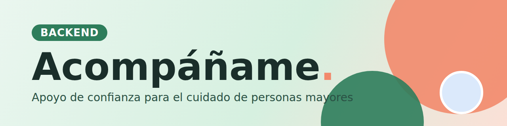
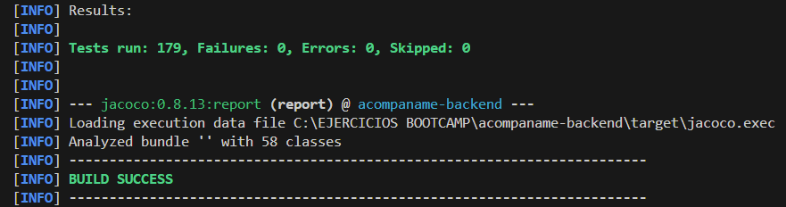
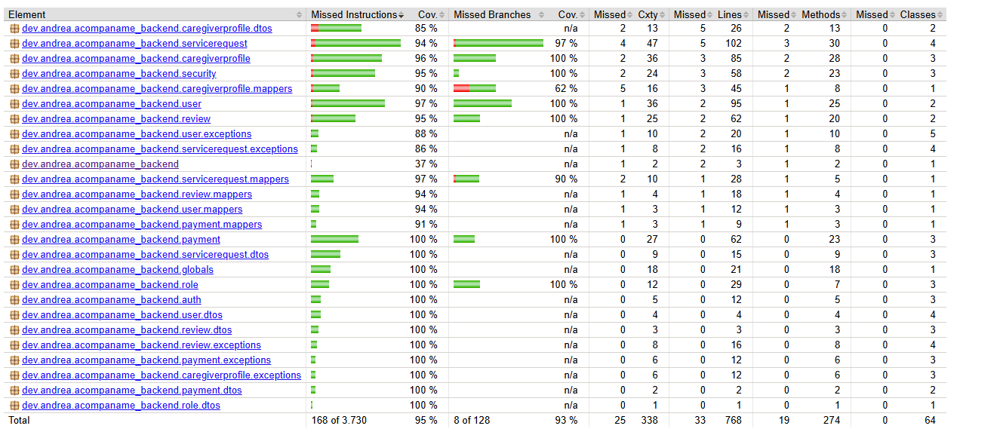

# 🤝 Acompáñame — Backend

**Acompáñame** is a marketplace that connects families who need care for a loved one (because of illness or dependency, at any age) with professional caregivers. It fills the gap between full-time residential care and the waiting lists of formal care, giving families a flexible alternative, especially those who live far from their relatives.

This repository contains the **REST API**, built with **Spring Boot**. The Vue.js front end lives in a separate repository (see [Project links](#-project-links)).

Final project of the Full Stack Web Development bootcamp (850 h) at **Factoría F5 — Digital Academy**.

    

> [!TIP]
> 📚 **Full documentation is in the [project wiki](https://github.com/AndreaVaGo/acompaname-backend/wiki).** This README has what you need to understand, run and test the back end; the details (architecture, data model, endpoints, security, tests, diagrams and decisions) are in the wiki.

---

## 📑 Table of contents

- [What the platform does](#-what-the-platform-does)
- [Tech stack](#-tech-stack)
- [Getting started](#-getting-started)
- [Configuration](#-configuration)
- [Architecture](#-architecture)
- [Business rules](#-business-rules)
- [API endpoints](#-api-endpoints)
- [Security](#-security)
- [Testing](#-testing)
- [Load tests](#-load-tests)
- [Production profile](#-production-profile)
- [Design, planning and decisions](#-design-planning-and-decisions)
- [Known limitations](#-known-limitations)
- [Roadmap](#-roadmap)
- [Project links](#-project-links)
- [Credits](#-credits)
- [Author](#-author)

---

## 📖 What the platform does

**Families** can:
- 📝 Sign up, recover their password and manage their account
- 🔎 Search caregiver profiles (filtering by age group and sorting by distance)
- 📋 Create service requests for one or several people (up to 5), each with name, age and age group
- 💬 Chat with the caregiver about a request
- 💳 See the amount to pay and pay it (simulated payment)
- ⭐ Rate the service once it is completed

**Caregivers** can:
- 🧑‍⚕️ Create a professional profile (specialty, experience, hourly rate, extra-person surcharge, age groups they care for, availability and photo)
- 📥 Receive requests and accept, reject or complete them
- 🗓️ Keep a calendar of busy time slots (one by one, repeated, or imported from an `.ics` file) so families only see them when they are free

**Administrators** can:
- 📊 See activity statistics (families, caregivers, requests, income, average rating), alerts and payment analytics
- 🚫 Block and unblock accounts
- 🗑️ Delete inappropriate reviews
- 💡 Read the suggestions sent by users

---

## 🛠 Tech stack

| Category | Technology |
|---|---|
| ☕ Language | Java 21 |
| 🍃 Framework | Spring Boot 4.1.1 |
| 🔐 Security | Spring Security, JWT (OAuth2 resource server), BCrypt |
| 🗃️ Persistence | Spring Data JPA / Hibernate |
| 🐬 Database | MySQL 8.0 (Docker) |
| 🔨 Build | Maven (wrapper included) |
| ✂️ Less boilerplate | Lombok |
| 🧪 Testing | JUnit 5, Mockito, MockMvc, Testcontainers, JaCoCo |
| 📈 Load testing | k6 (run with Docker) |
| 🛡️ Bot protection | Cloudflare Turnstile (CAPTCHA) |
| ✉️ Email | Spring Mail (SMTP) |
| 🌍 Geocoding | OpenStreetMap Nominatim (no API key) |
| 🐳 Containers | Docker / Docker Compose |

---

## 🚀 Getting started

### Requirements

- Java 21
- Maven (or the included wrapper `./mvnw`)
- Docker and Docker Compose
- Git

> [!IMPORTANT]
> Docker must be running before you start the application or run the tests: both need the database (the integration tests start their own MySQL with Testcontainers).

### Steps

1. **Clone the repository**
```bash
git clone https://github.com/AndreaVaGo/acompaname-backend.git
cd acompaname-backend
```

2. **Start the database**
```bash
docker compose up -d
```
This creates a MySQL container (`acompaname-mysql`) with the database `acompaname_db` on port `3306`.

3. **Run the application**
```bash
./mvnw spring-boot:run
```
The API is available at `http://localhost:8080/api/v1`.

On startup the application creates the roles `FAMILIA`, `CUIDADOR` and `ADMIN` if they do not exist (`RoleInitializer`), so sign-up works from the first run on an empty database.

4. **(Optional) Create the administrator.** Define `ADMIN_EMAIL` and `ADMIN_PASSWORD` before starting; if they are empty, no administrator is created.
```bash
# Git Bash / Linux / macOS
export ADMIN_EMAIL=admin@example.com
export ADMIN_PASSWORD=choose-a-password
./mvnw spring-boot:run
```
```powershell
# PowerShell
$env:ADMIN_EMAIL="admin@example.com"
$env:ADMIN_PASSWORD="choose-a-password"
./mvnw spring-boot:run
```

5. **(Optional) Sample data for development.** With the `dev` profile the application creates one family, two caregivers with profiles, requests in several states and some payments. Nothing is duplicated on restart, and it never runs in production or in the tests.
```bash
SPRING_PROFILES_ACTIVE=dev ./mvnw spring-boot:run
```
Test users, all with password `Password123!`: `familia@test.com` (family), `cuidador@test.com` and `cuidadora@test.com` (caregivers).

6. **Run the tests**
```bash
./mvnw test
```

---

## 🔐 Configuration

Everything is read from environment variables. If a variable is missing, a local development value is used, so the project starts with no setup. Copy `.env.example` to `.env` to change the database values (Docker Compose reads it; the file is in `.gitignore`).

```bash
cp .env.example .env
```

> [!NOTE]
> `.env` is read by **Docker Compose**, not by Spring Boot. Variables for the application (`ADMIN_EMAIL`, `JWT_SECRET`, `CAPTCHA_*`…) must be defined in the terminal that starts it, or in the hosting platform.

| Variable | Default | What it is for |
|---|---|---|
| `DB_HOST`, `DB_PORT`, `DB_NAME` | `localhost`, `3306`, `acompaname_db` | Database location |
| `DB_USER`, `DB_PASSWORD` | `acompaname_user`, `acompaname_pass` | Database credentials |
| `DB_ROOT_PASSWORD` | `root` | MySQL root password (Docker Compose only) |
| `JPA_DDL_AUTO` | `update` | How Hibernate handles tables (`validate` in production) |
| `SHOW_SQL` | `false` | Print the SQL Hibernate runs |
| `CORS_ORIGINS` | `http://localhost:5173` | Front-end origin(s) allowed to call the API (comma separated) |
| `JWT_SECRET` | development key | Key that signs the login tokens (at least 32 characters) |
| `JWT_EXPIRATION_MINUTES` | `120` | Token lifetime |
| `ADMIN_EMAIL`, `ADMIN_PASSWORD` | _(empty)_ | Administrator created at startup; empty means none |
| `RATE_LIMIT_MAX_REQUESTS`, `RATE_LIMIT_WINDOW_SECONDS` | `5`, `60` | Login and sign-up limit per IP address |
| `CAPTCHA_ENABLED` | `false` (`true` in prod) | Require a Turnstile token on login and sign-up |
| `CAPTCHA_SECRET` | _(empty)_ | Turnstile secret key (required when the CAPTCHA is enabled) |
| `FOTO_MAX_BYTES` | `300000` | Maximum size of a profile photo (JPG, PNG or WebP) |
| `MAIL_ENABLED` | `false` (`true` in prod) | `false` writes the emails to the log instead of sending them |
| `MAIL_FROM`, `MAIL_HOST`, `MAIL_PORT`, `MAIL_USER`, `MAIL_PASSWORD` | local values | SMTP settings |
| `FRONTEND_URL` | `http://localhost:5173` | Used to build the link in the password-reset email |
| `PASSWORD_RESET_MINUTES` | `60` | Validity of the password-reset link |
| `PAGOS_RECARGO_PERSONA_EXTRA` | `0.25` | Default surcharge per extra person (25 %) |
| `GEOCODING_ENABLED` | `true` | `false` stops calls to Nominatim (distance search finds nothing) |
| `FORWARD_HEADERS_STRATEGY` | `none` (`native` in prod) | Read the real client IP behind a reverse proxy |

> [!WARNING]
> The default values are **for local development only**. In a real deployment every secret must be new and different (see [Production profile](#-production-profile)).

### CAPTCHA (Cloudflare Turnstile)

The CAPTCHA protects the login and the sign-up. It is off by default (development, tests and load tests). When `CAPTCHA_ENABLED=true`, the back end rejects (`400`) those two requests unless the body carries a valid `captchaToken`; it checks the token with Cloudflare, tokens are single-use, and if Cloudflare cannot be reached the request is rejected (fail closed).

To try it without a Cloudflare account, use Cloudflare's test keys: front-end site key `1x00000000000000000000AA`, and as secret `1x0000000000000000000000000000000AA` (always passes) or `2x0000000000000000000000000000000AA` (always fails). The secret key never goes in the code.

---

## 🏗 Architecture

A classic **layered architecture** (`Controller` → `Service` → `Repository` → `Entity`) with DTOs and mappers between the controller and the entities, and a `GlobalExceptionHandler` that turns exceptions into clear HTTP codes. Code is organised by feature, one package per area:

| Package | Responsibility |
|---|---|
| `auth`, `security`, `captcha` | Login, JWT, rate limiting, CAPTCHA |
| `user`, `role`, `passwordreset` | Accounts, roles, password recovery |
| `caregiverprofile`, `geolocation` | Caregiver profiles, photo validation, distance search |
| `servicerequest` | Requests, states, people to care for |
| `payment` | Payments and amount calculation |
| `review`, `chat`, `suggestion` | Ratings, per-request chat, user suggestions |
| `schedule` | Caregiver busy time slots (manual, repeated, `.ics` import) |
| `admin` | Statistics, alerts, moderation, payment analytics |
| `mail`, `devdata`, `globals`, `generics` | Email, sample data, shared enums and exception handler |

```
HTTP client → Controller (validates the input DTO) → Service (business rules) → Repository (Spring Data JPA) → Entity (tables)
```

👉 Package structure and patterns: [Architecture and patterns](https://github.com/AndreaVaGo/acompaname-backend/wiki/Arquitectura-y-patrones). Entity-relationship and class diagrams: [Data model](https://github.com/AndreaVaGo/acompaname-backend/wiki/Modelo-de-datos).

---

## 📏 Business rules

- **Request states:** `PENDIENTE` → `ACEPTADA` or `RECHAZADA`; `ACEPTADA` → `COMPLETADA`. Any other change returns `409`. The rules live in one place (`EstadoSolicitud`).
- **Editing:** a family can change or delete a request only while it is `PENDIENTE`.
- **People and age groups:** a request has 1 to 5 people, each with name, age and an age group (`BEBES`, `NINOS`, `ADOLESCENTES`, `ADULTOS`, `MAYORES`, `DISCAPACIDAD_DEPENDENCIA`). If the caregiver has marked age groups in their profile, they must cover **all** the groups of the request (`400` otherwise). No groups marked means no restriction.
- **No double booking:** accepting a request is rejected (`409`) if it overlaps another accepted request or one of the caregiver's busy slots. Slots that only touch do not conflict.
- **Payment amount** (always calculated by the server, never sent by the client), created when the caregiver completes the request:

  `amount = hours × hourly rate × (1 + surcharge × extra people)`

  The first person pays the full rate; each extra person adds a surcharge (the caregiver's own percentage, or 25 % by default). A started hour counts as a whole hour, minimum one. The hourly rate includes travel.
- **Ratings:** only a `COMPLETADA` request can be rated, and only once per request (`409` otherwise).
- **Photos:** JPG, PNG or WebP, up to 300 KB after decoding, stored as Base64 text.
- **Emails** (new/accepted/rejected/completed request, payment received, new chat message, password reset) never include names of cared-for people or addresses. If an email fails, it is only logged: the status change or the payment never fails because of an email.

---

## 📡 API endpoints

Base prefix: `/api/v1`. The token goes in `Authorization: Bearer <token>`. 🔓 = public.

| Area | Endpoints | Who |
|---|---|---|
| 🔑 Auth | `POST /login` 🔓 | everyone |
| 🔁 Password recovery | `POST /olvide-password` 🔓, `POST /restablecer-password` 🔓 | everyone |
| 👤 Users | `POST /usuarios` 🔓 (sign-up); `GET /usuarios/{id}`; `DELETE /usuarios/{id}`; `PATCH /usuarios/{id}/password`; `PATCH /usuarios/{id}/contacto` | owner only |
| 🎭 Roles | `GET /roles` 🔓 | everyone |
| 🧑‍⚕️ Caregivers | `GET /cuidadores` 🔓, `GET /cuidadores/{id}` 🔓, `GET /cuidadores/cerca?lugar=` 🔓 (distance search), `GET /cuidadores/mi-perfil`; `POST`, `PUT /{id}`, `DELETE /{id}` | `CUIDADOR` (own profile) |
| 📋 Requests | `POST /solicitudes`, `PUT /{id}`, `DELETE /{id}`; `GET /solicitudes/mis-solicitudes`, `GET /{id}`; `PATCH /{id}/estado`; `GET /solicitudes/cuidadores-ocupados` 🔓 (ids only) | `FAMILIA` creates, edits and deletes; the caregiver changes the state |
| 💳 Payments | `GET /pagos`, `GET /pagos/{id}`, `PATCH /pagos/{id}/pagar` | the family of the request pays |
| ⭐ Ratings | `GET /valoraciones/cuidador/{id}` 🔓; `POST`, `PUT /{id}`, `DELETE /{id}` | author only |
| 💬 Chat | `GET`/`POST /solicitudes/{id}/mensajes`, `GET /mensajes/no-leidos` | the family and the caregiver of the request |
| 🗓️ Busy slots | `GET`, `POST`, `DELETE /bloques-ocupados/{id}`, `POST /bloques-ocupados/repetir`, `POST /bloques-ocupados/importar` | `CUIDADOR` |
| 💡 Suggestions | `POST /sugerencias` | `FAMILIA`, `CUIDADOR` |
| 🛡️ Admin | `/admin/estadisticas`, `/admin/avisos`, `/admin/cuidadores/mejor-valorados`, `/admin/valoraciones/ultimas`, `DELETE /admin/valoraciones/{id}`, `/admin/usuarios`, `PATCH /admin/usuarios/{id}/activo`, `/admin/solicitudes?estado=`, `/admin/pagos`, `/admin/pagos/resumen`, `/admin/sugerencias` | `ADMIN` |

The administrator **observes and moderates**: they block accounts and delete reviews, but cannot edit requests, payments or users, and cannot impersonate anyone.

Typical errors: `400` (invalid data or CAPTCHA), `401` (bad credentials or blocked account), `403` (resource of another user or wrong role), `404`, `409` (state change not allowed, overlap, duplicates) and `429` (too many attempts).

👉 Every endpoint with method, access level and a request example: [API endpoints](https://github.com/AndreaVaGo/acompaname-backend/wiki/Endpoints-de-la-API).

---

## 🔒 Security

- 🔑 **Authentication:** login returns a **JWT** (signed with `JWT_SECRET`, lifetime `JWT_EXPIRATION_MINUTES`). The API is stateless: every request carries its token, and the user is loaded from the database each time, so blocking an account takes effect immediately.
- 🔐 **Passwords:** stored with **BCrypt**, never returned; a strong-password rule is enforced at sign-up and on change.
- 🎭 **Roles:** `FAMILIA`, `CUIDADOR` and `ADMIN` decide which endpoints each user can call. Everything under `/admin` is for `ADMIN` only.
- 🛡️ **Ownership:** services check that the resource belongs to the logged-in user (`403` otherwise), so nobody can read or change other people's data by guessing ids. Input DTOs cannot set sensitive fields (role, state, amount, owner).
- 🚦 **Rate limiting:** login and sign-up are limited per IP (5 per minute by default, `429` beyond that). Failed logins leave a warning in the log with no email or password.
- 🤖 **CAPTCHA:** Cloudflare Turnstile on login and sign-up (see [Configuration](#captcha-cloudflare-turnstile)).
- 🚫 **Blocked accounts** get the same `401` as a wrong password, so the API does not reveal which emails exist.
- 🔁 **Password recovery:** single-use, expiring tokens sent by email; the response is the same whether or not the email exists.
- 🌐 **CORS:** only the front-end origin is allowed.
- 🧱 **Headers:** `Content-Security-Policy: default-src 'none'`, `Referrer-Policy: no-referrer`, `X-Content-Type-Options`, `X-Frame-Options` and HSTS over HTTPS.
- 🖼️ **Photos** are validated by size and by real image type, not by file name.
- 🧯 **Errors:** the production profile never exposes messages, stack traces or SQL.

👉 More detail: [Security](https://github.com/AndreaVaGo/acompaname-backend/wiki/Seguridad).

---

## 🧪 Testing

The suite has **1,192 tests** (last full run) covering business logic, the HTTP layer, security and integration with a real database:

| Type | What it checks |
|---|---|
| 🧩 Services (Mockito) | Business rules and errors of each module |
| 🌐 Controllers (MockMvc) | Status codes and JSON of every endpoint |
| 🧱 Entities, mappers and DTOs | Constructors, accessors and conversions |
| 🐳 Integration (Testcontainers) | Repositories and full requests against a real MySQL, including access rules and ownership |
| 🛡️ Security | Roles, blocked accounts, rate limiting, CAPTCHA enabled/disabled, production profile |
| 🧯 Exceptions | Every error is translated to the right HTTP code |

```bash
./mvnw test
```

Running everything is slow because some tests start MySQL with Docker. While developing, run a group or a single test:

```bash
./mvnw test -Dtest='Solicitud*Test'
./mvnw test -Dtest=SolicitudServiceImplHorasTest
./mvnw test -Dtest=SolicitudServiceImplHorasTest#methodName
```

The integration tests share two MySQL containers (one for repository tests and one for full-application tests, in `src/test/java/.../support`), so Docker starts only two databases per run. Run the full suite once before merging.

Coverage is measured with **JaCoCo**: 96 % of instructions and 95 % of branches at the last measurement (the required minimum was 70 %).




👉 What each group of tests checks, including edge cases: [Testing](https://github.com/AndreaVaGo/acompaname-backend/wiki/Testing).

---

## 📈 Load tests

The `load-tests/` folder has [k6](https://k6.io) scripts for the main scenarios (public caregiver search, login, and create/list/delete requests). Run them **only on your own machine**, never against a published site. How to run them, with or without k6 installed, is in [`load-tests/README.md`](load-tests/README.md).

Results on a development laptop (up to 100 virtual users, 0 % errors):

| Scenario | Before | After | Fix |
|---|---|---|---|
| Caregiver search (p95) | 2.76 s | 241 ms | N+1 queries replaced by `JOIN FETCH` and grouped queries |
| Create / list / delete requests (p95) | 23.5 s | 1.15 s | N+1 removed; the people of each request load with `@Fetch(SUBSELECT)` |
| Login | — | ~30 logins per second | Not a bug: BCrypt is slow on purpose |

The request test fails above a p95 of 1.5 s. The login limit (5 per minute per IP) would cut the load on purpose, so raise `RATE_LIMIT_MAX_REQUESTS` only during the test and turn it back afterwards.

> [!NOTE]
> The lists (`mis-solicitudes`, caregivers) return every record, and photos travel as Base64 inside them. With one family accumulating more than 1,600 requests the response was hundreds of MB. Pagination and storing photos as files are on the [roadmap](#-roadmap).

---

## 🚀 Production profile

Activated with `SPRING_PROFILES_ACTIVE=prod`. It has **no default values** for secrets: if `DB_USER`, `DB_PASSWORD`, `JWT_SECRET`, `CAPTCHA_SECRET`, `MAIL_*` or `FRONTEND_URL` is missing, the application does not start, so development keys are never used by mistake. It also:

- sets `ddl-auto=validate` (Hibernate only checks the tables; the **first** time, with an empty database, start once with `JPA_DDL_AUTO=update` and remove it afterwards),
- hides error messages, stack traces and SQL, and logs at `INFO`,
- enables the CAPTCHA and real SMTP email,
- reads the real client IP from `X-Forwarded-For` only when it comes from a trusted proxy (`FORWARD_HEADERS_STRATEGY=native`), so the rate limit counts per person and not per proxy.

---

## 🎨 Design, planning and decisions

The design went from sketches to wireframes, mockups and a prototype, for mobile, tablet and desktop. The project was planned in **JIRA** (epics, user stories with acceptance criteria and technical tasks, organised in sprints).

- 🎨 **Figma:** https://www.figma.com/design/iNrrCJOe6CkQXTxhGzK7rj/Acomp%C3%A1%C3%B1ame
- 💜 **Lovable prototype:** https://care-connection-hub-18.lovable.app
- 📊 **JIRA board:** https://saludosalamanecer-1780468848301.atlassian.net/jira/software/projects/ACOM/boards/34/timeline?rangeMode=MONTHS

📄 Process and problems found: [docs/decisiones-tecnicas.pdf](docs/decisiones-tecnicas.pdf) (in Spanish). Some of the main decisions:

- ✅ **Roles in their own table** (`@ManyToMany`) instead of an enum, following the Spring Security standard.
- ✅ **DTOs on every input and output**, so entities (and passwords) are never exposed and *mass assignment* is avoided.
- ✅ **Per-entity exceptions + one `GlobalExceptionHandler`**, with clear `400`, `403`, `404`, `409` and `429` codes.
- ✅ **Ownership checked in the service**, even if the id of another user's resource is known.
- ✅ **Rules in one place:** request state transitions in `EstadoSolicitud`, age groups in the `GrupoEdad` enum, the amount in `CalculoDeImporte`.
- ✅ **Amounts calculated by the server**, never accepted from the client.
- ✅ **Optional collaborators behind an interface** (email, CAPTCHA, geocoding), with a disabled implementation for development and tests.
- ✅ **Real-MySQL integration tests (Testcontainers)** for what mocks cannot catch, such as Hibernate session problems at startup.
- ✅ **Administrator created from environment variables**, with no credentials in the code or the repository.

👉 All decisions with their reasons: [Decisions and roadmap](https://github.com/AndreaVaGo/acompaname-backend/wiki/Decisiones-y-roadmap).

---

## ⚠️ Known limitations

> [!WARNING]
> Areas identified as pending, listed openly.

- 💳 **Simulated payments:** there is no payment gateway. The payment is created when the caregiver completes the request and is marked as paid with `PATCH /pagos/{id}/pagar`.
- 📃 **Lists are not paginated:** some endpoints return every record (see [Load tests](#-load-tests)).
- 🖼️ **Photos are stored as Base64 text** in the database, reduced to at most 300 KB, which makes caregiver lists heavy.
- 🔐 **No two-factor authentication** yet.
- 🛡️ **A single administrator**, created from environment variables; there is no screen to create more.
- 🔒 **A blocked account is not told why:** it gets the same `401` as a wrong password. This is intentional for privacy.
- 🗝️ **Development defaults** remain in `application.properties` and `docker-compose.yml`; the production profile has none.

---

## 🗺 Roadmap

> [!TIP]
> Phase 2 features, outside the delivered scope.

- 💳 Real payment gateway (Stripe, test mode first) and a platform fee
- 📃 Pagination of the lists
- 🖼️ Store profile photos as files in external storage
- 🔐 Two-factor authentication
- 📱 Installable web app (PWA)
- 📄 PDF reports
- ☁️ Deployment (Docker images and a cloud database)

---

## 🔗 Project links

| Resource | Link |
|---|---|
| 🍃 Back-end repository | [github.com/AndreaVaGo/acompaname-backend](https://github.com/AndreaVaGo/acompaname-backend) |
| 🖥️ Front-end repository | [github.com/AndreaVaGo/acompaname-frontend](https://github.com/AndreaVaGo/acompaname-frontend) |
| 📚 Wiki | [github.com/AndreaVaGo/acompaname-backend/wiki](https://github.com/AndreaVaGo/acompaname-backend/wiki) |
| 🎤 Presentation | [docs/presentacion.pdf](docs/presentacion.pdf) |
| 📊 JIRA board | https://saludosalamanecer-1780468848301.atlassian.net/jira/software/projects/ACOM/boards/34/timeline?rangeMode=MONTHS |
| 🎨 Figma design | https://www.figma.com/design/iNrrCJOe6CkQXTxhGzK7rj/Acomp%C3%A1%C3%B1ame |
| 💜 Lovable prototype | https://care-connection-hub-18.lovable.app |

---

## 🙏 Credits

- Login and sign-up photo (front end): [Woman and man holding hands](https://unsplash.com/es/fotos/mujer-y-hombre-tomados-de-la-mano-0EVKn3-5JSU) by Roman Kraft on [Unsplash](https://unsplash.com), used under the Unsplash License.
- Bot protection by [Cloudflare Turnstile](https://www.cloudflare.com/products/turnstile/); location search by [OpenStreetMap Nominatim](https://nominatim.org) (© OpenStreetMap contributors).

---

## 👩‍💻 Author

Developed by **Andrea Vallina González** as the final project of the Full Stack Web Development bootcamp at **Factoría F5 — Digital Academy**.

- 🐙 GitHub: [@AndreaVaGo](https://github.com/AndreaVaGo)
- 💼 LinkedIn: [Andrea Vallina González](https://www.linkedin.com/in/andrea-vallina-gonzalez/)
