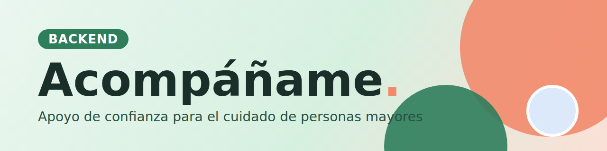
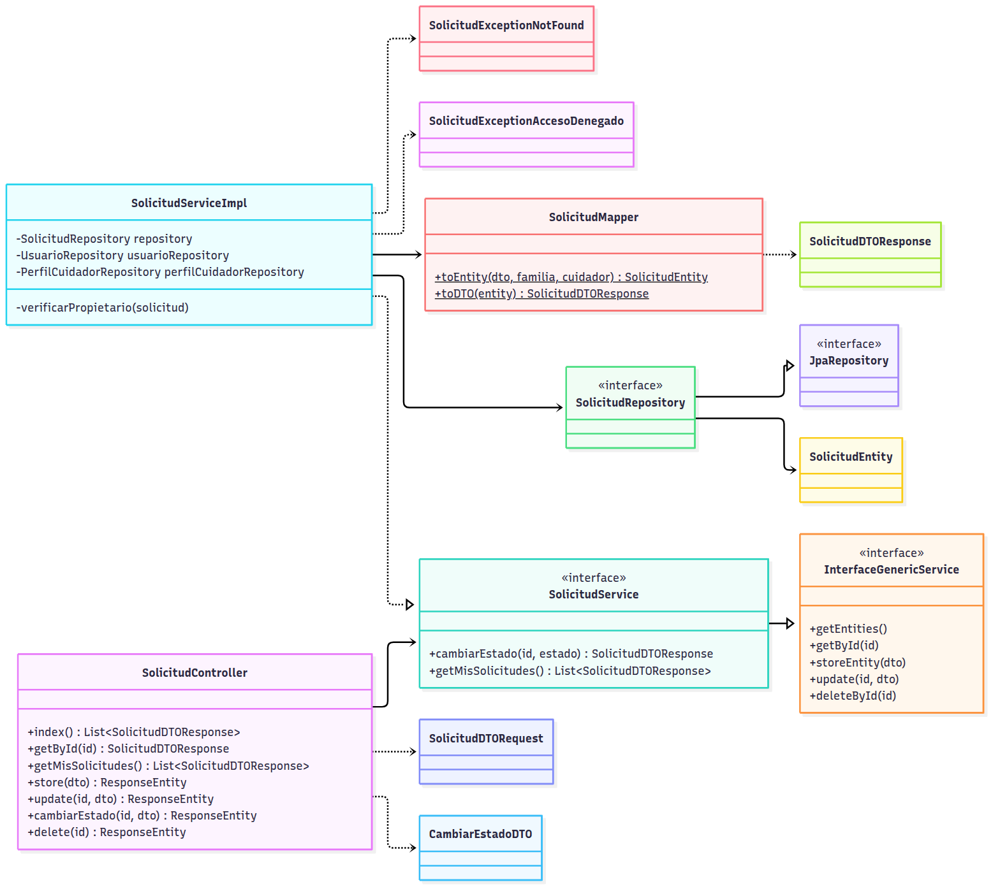
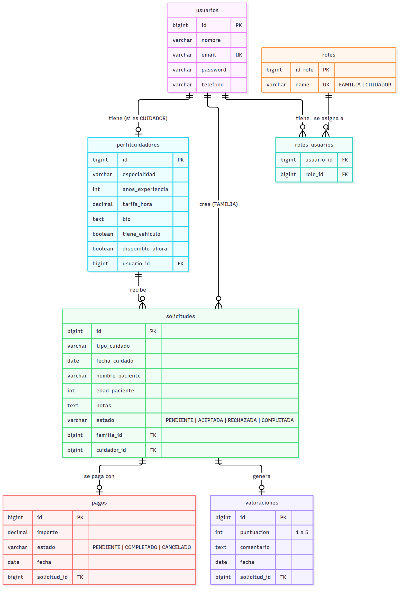
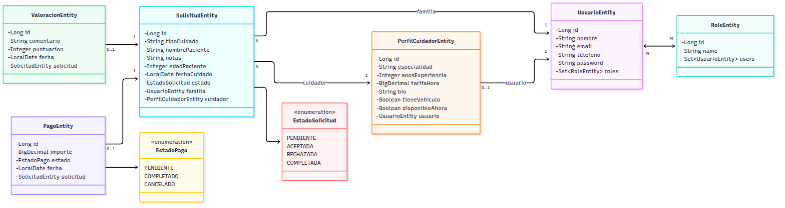
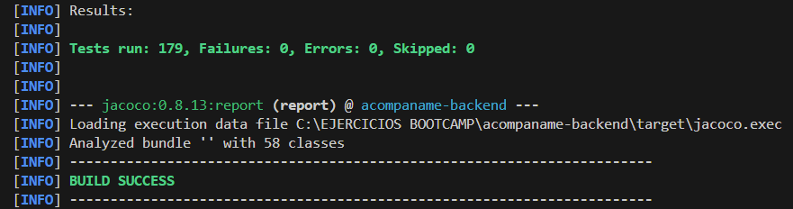
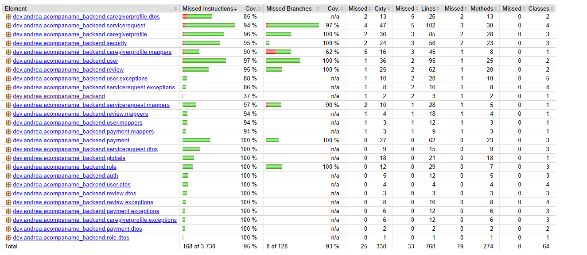
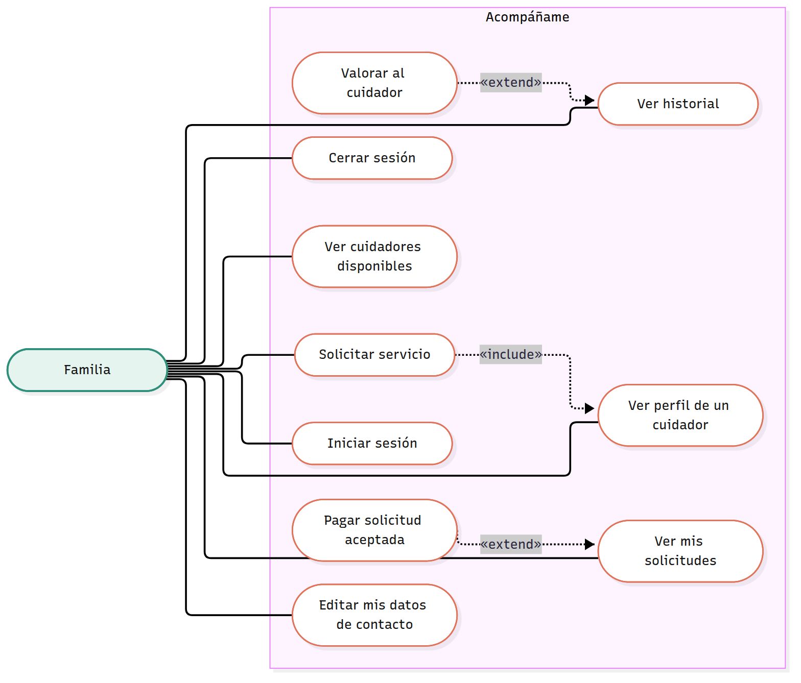
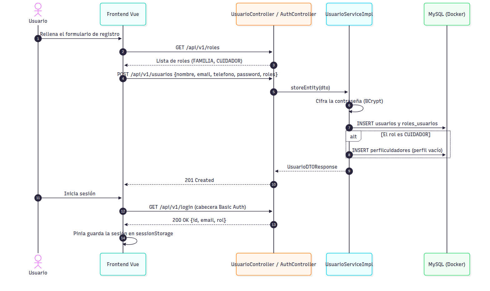
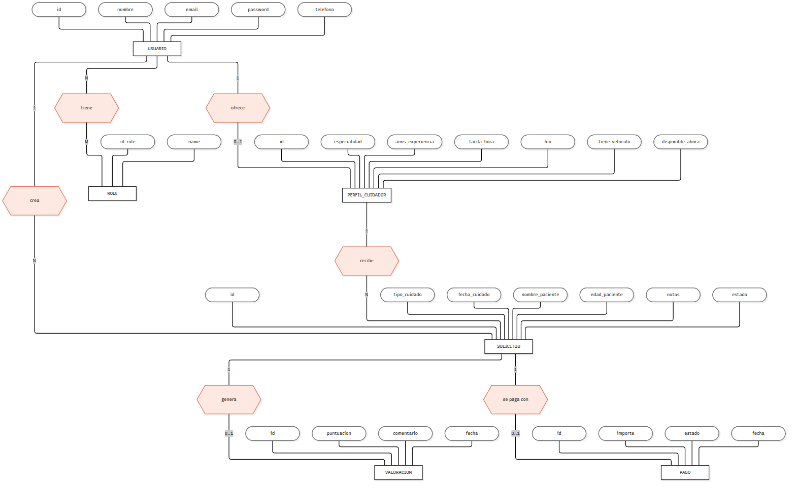
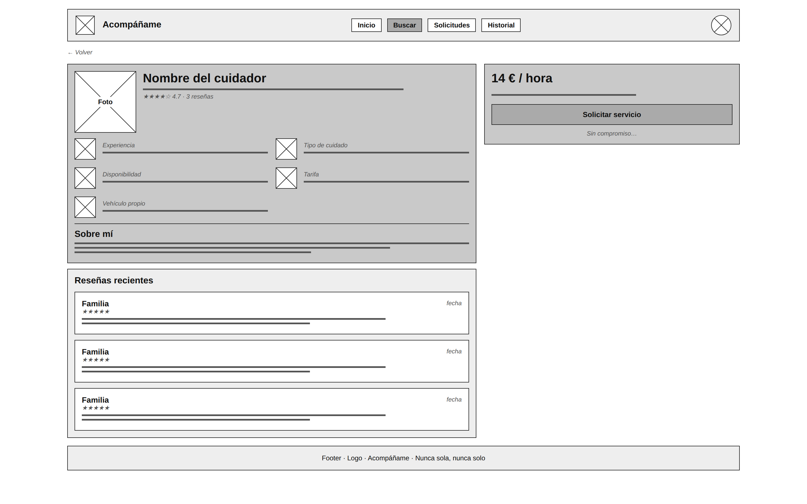

# 🤝 Acompáñame — Backend

**Acompáñame** es una plataforma de marketplace que conecta a familias que necesitan cuidados para un ser querido con cuidadores profesionales verificados. Nace para cubrir el hueco entre la atención residencial a tiempo completo y las listas de espera de la atención formal, dando una alternativa flexible tanto a personas mayores como a familias que viven lejos de sus seres queridos.

Este repositorio contiene la **API REST** del proyecto, desarrollada con **Spring Boot**. El frontend (Vue.js) vive en un repositorio independiente, enlazado más abajo.

Proyecto final del bootcamp de Desarrollo Web Full Stack (850h) en **Factoría F5 — Digital Academy**.

    

---

## 📑 Tabla de contenidos

- [Descripción del proyecto](#-descripción-del-proyecto)
- [Tecnologías utilizadas](#-tecnologías-utilizadas)
- [Arquitectura y patrones de diseño](#-arquitectura-y-patrones-de-diseño)
- [Modelo de datos](#-modelo-de-datos)
- [Instalación y puesta en marcha](#-instalación-y-puesta-en-marcha)
- [Configuración](#-configuración)
- [Endpoints de la API](#-endpoints-de-la-api)
- [Seguridad](#-seguridad)
- [Testing](#-testing)
- [Diagramas técnicos](#-diagramas-técnicos)
- [Diseño y prototipo](#-diseño-y-prototipo)
- [Gestión del proyecto](#-gestión-del-proyecto)
- [Decisiones técnicas](#-decisiones-técnicas)
- [Limitaciones conocidas](#-limitaciones-conocidas)
- [Roadmap / Mejoras futuras](#-roadmap--mejoras-futuras)
- [Enlaces del proyecto](#-enlaces-del-proyecto)
- [Autoría](#-autoría)

---

## 📖 Descripción del proyecto

**Acompáñame** resuelve un problema real: encontrar apoyo puntual y de confianza para el cuidado de personas mayores o dependientes, sin necesidad de contratar servicios residenciales completos.

La plataforma permite a las **familias**:
- 📝 Registrarse y gestionar su cuenta
- 🔎 Buscar y consultar perfiles de cuidadores
- 📋 Crear solicitudes de servicio detallando el tipo de cuidado necesario
- 💳 Pagar el servicio (pago simulado)
- ⭐ Valorar el servicio recibido una vez completado

Y a los **cuidadores**:
- 🧑‍⚕️ Registrarse y crear su perfil profesional (especialidad, experiencia, tarifa, disponibilidad y foto)
- 📥 Consultar y gestionar las solicitudes que reciben
- ✅ Aceptar, rechazar o marcar como completadas las solicitudes

---

## 🛠 Tecnologías utilizadas

| Categoría | Tecnología |
|---|---|
| ☕ Lenguaje | Java 21 |
| 🍃 Framework | Spring Boot 4.1.1 |
| 🔐 Seguridad | Spring Security (autenticación Basic Auth + roles) |
| 🗃️ Persistencia | Spring Data JPA / Hibernate |
| 🐬 Base de datos | MySQL 8.0 (dockerizada) |
| 🔨 Build tool | Maven |
| ✂️ Menos código repetido (getters, setters, constructores) | Lombok |
| 🧪 Testing | JUnit 5, Mockito, MockMvc, Testcontainers |
| 🐳 Contenerización | Docker / Docker Compose |
| 🌿 Control de versiones | Git / GitHub |

---

## 🏗 Arquitectura y patrones de diseño

El backend sigue una **arquitectura en capas** (MVC) clásica de Spring Boot, aplicando principios SOLID y buenas prácticas de diseño orientado a objetos:

```
Cliente (HTTP)
      │
      ▼
 Controller   ──►  recibe la petición, valida el DTO de entrada, delega en el Service
      │
      ▼
   Service    ──►  contiene la lógica de negocio; interfaz + implementación
      │
      ▼
  Repository  ──►  acceso a datos (Spring Data JPA)
      │
      ▼
   Entity     ──►  representación de las tablas en base de datos
```

Un paquete por funcionalidad:

```
dev.andrea.acompaname_backend
├── auth             Login / logout
├── generics         InterfaceGenericService (contrato CRUD común)
├── globals          GlobalExceptionHandler
├── payment          Pagos
├── caregiverprofile Perfiles de cuidador
├── role             Roles
├── security         SecurityConfiguration, JpaUserDetailsService
├── servicerequest   Solicitudes de servicio
├── user             Usuarios
└── review           Valoraciones
```



**Patrones y principios aplicados:**

- 📦 **DTO (Data Transfer Object):** las entidades JPA nunca se exponen directamente en la API. Cada recurso tiene su <mark>DTORequest</mark> (datos de entrada, con validación) y <mark>DTOResponse</mark> (datos de salida, sin campos sensibles como la contraseña).
- 🔄 **Mapper:** clases estáticas dedicadas a convertir entre <mark>Entity</mark> ↔ <mark>DTO</mark>, manteniendo el resto del código libre de esa lógica de transformación.
- 🧬 **Interfaces genéricas:** <mark>InterfaceGenericService&lt;Entity, DTORequest, DTOResponse&gt;</mark> centraliza la firma de los métodos CRUD comunes a las entidades, evitando duplicación de código.
- 💉 **Inyección de dependencias por constructor:** en todos los <mark>Service</mark> y <mark>Controller</mark>, así las dependencias no se pueden cambiar por error y es más fácil probarlas en los tests (en vez de usar <mark>@Autowired</mark> en el atributo).
- 🚨 **Excepciones personalizadas:** cada entidad cuenta con su propia jerarquía de excepciones (<mark>XException</mark> → <mark>XExceptionNotFound</mark>, <mark>XExceptionAccesoDenegado</mark>), capturadas de forma centralizada por un <mark>GlobalExceptionHandler</mark> (<mark>@RestControllerAdvice</mark>) que devuelve respuestas claras y con el código HTTP correcto.
- 🔒 **Encapsulación:** todos los campos de las entidades son privados, con acceso exclusivo a través de getters/setters.

---

## 🗄 Modelo de datos

El sistema gira en torno a **seis entidades principales**:

| Entidad | Descripción |
|---|---|
| 👤 <mark>UsuarioEntity</mark> | Usuario del sistema (familia o cuidador). Relación <mark>@ManyToMany</mark> con <mark>RoleEntity</mark>. |
| 🎭 <mark>RoleEntity</mark> | Rol del usuario (<mark>FAMILIA</mark> / <mark>CUIDADOR</mark>). |
| 🧑‍⚕️ <mark>PerfilCuidadorEntity</mark> | Perfil profesional de un cuidador, con su foto guardada como texto. Relación <mark>@OneToOne</mark> con <mark>UsuarioEntity</mark>. |
| 📋 <mark>SolicitudEntity</mark> | Solicitud de servicio de una familia a un cuidador. Relaciones <mark>@ManyToOne</mark> con <mark>UsuarioEntity</mark> (familia) y <mark>PerfilCuidadorEntity</mark> (cuidador). |
| ⭐ <mark>ValoracionEntity</mark> | Valoración de una solicitud completada. Relación <mark>@OneToOne</mark> con <mark>SolicitudEntity</mark>. |
| 💳 <mark>PagoEntity</mark> | Pago de una solicitud (<mark>PENDIENTE</mark>, <mark>COMPLETADO</mark>, <mark>CANCELADO</mark>). Relación <mark>@OneToOne</mark> con <mark>SolicitudEntity</mark>. |

### Diagrama Entidad-Relación



### Diagrama de clases



---

## 🚀 Instalación y puesta en marcha

### Requisitos previos

- Java 21
- Maven (o usar el wrapper <mark>./mvnw</mark> incluido)
- Docker y Docker Compose
- Git

> [!IMPORTANT]
> Docker tiene que estar en marcha antes de arrancar la aplicación y de ejecutar los tests: los necesitan la base de datos y los tests de integración.

### Pasos

1. **Clona el repositorio**
```bash
   git clone https://github.com/AndreaVaGo/acompaname-backend.git
   cd acompaname-backend
```

2. **Levanta la base de datos con Docker Compose**
```bash
   docker compose up -d
```
   Esto crea un contenedor MySQL (<mark>acompaname-mysql</mark>) con la base de datos <mark>acompaname_db</mark>, disponible en el puerto <mark>3306</mark>.

3. **Arranca la aplicación**
```bash
   ./mvnw spring-boot:run
```
   La API quedará disponible en <mark>http://localhost:8080/api/v1</mark>

   Al arrancar, la aplicación crea sola los roles <mark>FAMILIA</mark> y <mark>CUIDADOR</mark> si no existen (clase <mark>RoleInitializer</mark>). Así el registro funciona desde la primera vez, con una base de datos nueva, sin insertar nada a mano.

4. **Ejecuta los tests** (opcional, pero recomendado; los de integración necesitan la base de datos del paso 2 arrancada con <mark>docker compose up -d</mark>)
```bash
   ./mvnw test
```

---

## 🔐 Configuración

La conexión a la base de datos se lee de variables de entorno. Si no existen, se usan los valores de desarrollo local, así que el proyecto arranca sin configurar nada.

| Variable | Valor por defecto | Para qué sirve |
|---|---|---|
| <mark>DB_HOST</mark> | <mark>localhost</mark> | Servidor de la base de datos |
| <mark>DB_PORT</mark> | <mark>3306</mark> | Puerto |
| <mark>DB_NAME</mark> | <mark>acompaname_db</mark> | Nombre de la base de datos |
| <mark>DB_USER</mark> | <mark>acompaname_user</mark> | Usuario |
| <mark>DB_PASSWORD</mark> | <mark>acompaname_pass</mark> | Contraseña del usuario |
| <mark>DB_ROOT_PASSWORD</mark> | <mark>root</mark> | Contraseña root (solo la usa Docker Compose) |
| <mark>CORS_ORIGINS</mark> | <mark>http://localhost:5173</mark> | Dirección del frontend que puede llamar a la API |
| <mark>JPA_DDL_AUTO</mark> | <mark>update</mark> | Cómo Hibernate gestiona las tablas (en producción se pondría <mark>validate</mark>) |
| <mark>SHOW_SQL</mark> | <mark>false</mark> | Si Hibernate escribe en la consola el SQL que ejecuta |

Otros ajustes:

| Ajuste | Valor |
|---|---|
| Contenedor | <mark>acompaname-mysql</mark> (mysql:8.0) |
| Volumen | <mark>acompaname_data</mark> |
| Prefijo de la API (<mark>api-endpoint</mark>) | <mark>api/v1</mark> |
| Origen CORS permitido (<mark>cors.allowed-origins</mark>) | <mark>http://localhost:5173</mark> por defecto; se cambia con la variable de entorno <mark>CORS_ORIGINS</mark> |

> [!TIP]
> Para usar otros valores, copia <mark>.env.example</mark> como <mark>.env</mark> en la raíz y cámbialos. Docker Compose lo lee solo. El archivo <mark>.env</mark> está en el <mark>.gitignore</mark>, así que no se sube a GitHub.

```bash
cp .env.example .env
```

> [!WARNING]
> Los valores por defecto son **solo para desarrollo local**. En un despliegue real hay que definir otras contraseñas en el entorno.

---

## 📡 Endpoints de la API

Todos los endpoints tienen como prefijo base: <mark>/api/v1</mark>

> [!TIP]
> **Leyenda de métodos:** 🟢 <mark>GET</mark> leer · 🟠 <mark>POST</mark> crear · 🔵 <mark>PUT</mark> actualizar · 🟣 <mark>PATCH</mark> cambiar un dato · 🔴 <mark>DELETE</mark> borrar.
>
> **Leyenda de acceso:** 🔓 público · 🔒 hay que iniciar sesión · 🧑‍⚕️ solo cuidadores · 👨‍👩‍👧 solo familias.

### Autenticación

| Método | Ruta | Descripción | Acceso |
|---|---|---|---|
| 🟢 <mark>GET</mark> | <mark>/login</mark> | Inicio de sesión (Basic Auth) | 🔓 Público (requiere credenciales válidas) |
| 🟢 <mark>GET</mark> | <mark>/logout</mark> | Cierre de sesión | 🔒 Autenticado |

### Usuarios (`/usuarios`)

| Método | Ruta | Descripción | Acceso |
|---|---|---|---|
| 🟠 <mark>POST</mark> | <mark>/usuarios</mark> | Registro de un nuevo usuario | 🔓 Público |
| 🟢 <mark>GET</mark> | <mark>/usuarios</mark> | Listar todos los usuarios | 🔒 Autenticado |
| 🟢 <mark>GET</mark> | <mark>/usuarios/{id}</mark> | Obtener un usuario por id | 🔒 Autenticado (propietario) |
| 🔵 <mark>PUT</mark> | <mark>/usuarios/{id}</mark> | Actualizar un usuario | 🔒 Autenticado (propietario) |
| 🔴 <mark>DELETE</mark> | <mark>/usuarios/{id}</mark> | Eliminar un usuario | 🔒 Autenticado (propietario) |
| 🟣 <mark>PATCH</mark> | <mark>/usuarios/{id}/password</mark> | Cambiar la contraseña | 🔒 Autenticado (propietario) |
| 🟣 <mark>PATCH</mark> | <mark>/usuarios/{id}/contacto</mark> | Actualizar nombre y teléfono | 🔒 Autenticado (propietario) |

### Roles (`/roles`)

| Método | Ruta | Descripción | Acceso |
|---|---|---|---|
| 🟢 <mark>GET</mark> | <mark>/roles</mark> | Listar los roles | 🔓 Público |

Los roles no se crean desde la API: se crean al arrancar la aplicación (<mark>RoleInitializer</mark>).

### Perfiles de cuidador (`/cuidadores`)

| Método | Ruta | Descripción | Acceso |
|---|---|---|---|
| 🟠 <mark>POST</mark> | <mark>/cuidadores</mark> | Crear perfil de cuidador | 🧑‍⚕️ Rol <mark>CUIDADOR</mark> |
| 🟢 <mark>GET</mark> | <mark>/cuidadores</mark> | Listar todos los perfiles | 🔓 Público |
| 🟢 <mark>GET</mark> | <mark>/cuidadores/{id}</mark> | Obtener un perfil por id | 🔓 Público |
| 🟢 <mark>GET</mark> | <mark>/cuidadores/mi-perfil</mark> | Obtener el perfil del cuidador autenticado | 🔒 Autenticado |
| 🔵 <mark>PUT</mark> | <mark>/cuidadores/{id}</mark> | Actualizar un perfil | 🧑‍⚕️ Rol <mark>CUIDADOR</mark> (propietario) |
| 🔴 <mark>DELETE</mark> | <mark>/cuidadores/{id}</mark> | Eliminar un perfil | 🧑‍⚕️ Rol <mark>CUIDADOR</mark> (propietario) |

### Solicitudes (`/solicitudes`)

| Método | Ruta | Descripción | Acceso |
|---|---|---|---|
| 🟠 <mark>POST</mark> | <mark>/solicitudes</mark> | Crear una solicitud de servicio | 👨‍👩‍👧 Rol <mark>FAMILIA</mark> |
| 🟢 <mark>GET</mark> | <mark>/solicitudes</mark> | Listar todas las solicitudes | 🔒 Autenticado |
| 🟢 <mark>GET</mark> | <mark>/solicitudes/{id}</mark> | Obtener una solicitud por id | 🔒 Autenticado |
| 🟢 <mark>GET</mark> | <mark>/solicitudes/mis-solicitudes</mark> | Solicitudes del usuario autenticado | 🔒 Autenticado |
| 🟢 <mark>GET</mark> | <mark>/solicitudes/cuidadores-ocupados?inicio=&fin=</mark> | Ids de los cuidadores con un servicio aceptado entre dos fechas (<mark>fin</mark> es opcional: sin ella se cuenta un solo día). La usa el buscador para ocultarlos | 🔓 Público (solo devuelve ids) |
| 🔵 <mark>PUT</mark> | <mark>/solicitudes/{id}</mark> | Actualizar una solicitud | 👨‍👩‍👧 Rol <mark>FAMILIA</mark> (propietario) |
| 🔴 <mark>DELETE</mark> | <mark>/solicitudes/{id}</mark> | Eliminar una solicitud | 👨‍👩‍👧 Rol <mark>FAMILIA</mark> (propietario) |
| 🟣 <mark>PATCH</mark> | <mark>/solicitudes/{id}/estado</mark> | Cambiar el estado (<mark>PENDIENTE</mark>, <mark>ACEPTADA</mark>, <mark>RECHAZADA</mark>, <mark>COMPLETADA</mark>). Aceptar falla con <mark>409</mark> si el cuidador ya tiene otro servicio aceptado en esas fechas | 🔒 Autenticado |

### Valoraciones (`/valoraciones`)

| Método | Ruta | Descripción | Acceso |
|---|---|---|---|
| 🟠 <mark>POST</mark> | <mark>/valoraciones</mark> | Crear una valoración | 🔒 Autenticado |
| 🟢 <mark>GET</mark> | <mark>/valoraciones</mark> | Listar solo las valoraciones del usuario (las que ha escrito la familia o las que ha recibido el cuidador) | 🔒 Autenticado |
| 🟢 <mark>GET</mark> | <mark>/valoraciones/{id}</mark> | Obtener una valoración por id | 🔒 Autenticado (familia o cuidador de esa solicitud) |
| 🟢 <mark>GET</mark> | <mark>/valoraciones/cuidador/{cuidadorId}</mark> | Valoraciones públicas de un cuidador | 🔓 Público |
| 🔵 <mark>PUT</mark> | <mark>/valoraciones/{id}</mark> | Actualizar una valoración | 🔒 Autenticado (propietario) |
| 🔴 <mark>DELETE</mark> | <mark>/valoraciones/{id}</mark> | Eliminar una valoración | 🔒 Autenticado (propietario) |

### Pagos (`/pagos`)

| Método | Ruta | Descripción | Acceso |
|---|---|---|---|
| 🟠 <mark>POST</mark> | <mark>/pagos</mark> | Crear un pago (solo de una solicitud aceptada o completada que aún no tenga uno; <mark>409</mark> si no) | 👨‍👩‍👧 Familia de la solicitud |
| 🟢 <mark>GET</mark> | <mark>/pagos</mark> | Listar los pagos del usuario | 🔒 Autenticado (familia o cuidador de la solicitud) |
| 🟢 <mark>GET</mark> | <mark>/pagos/{id}</mark> | Obtener un pago por id | 🔒 Autenticado (familia o cuidador de la solicitud) |
| 🔵 <mark>PUT</mark> | <mark>/pagos/{id}</mark> | Actualizar el importe (solo mientras está pendiente; <mark>409</mark> si no) | 👨‍👩‍👧 Familia de la solicitud |
| 🔴 <mark>DELETE</mark> | <mark>/pagos/{id}</mark> | Eliminar un pago (solo mientras está pendiente; <mark>409</mark> si no) | 👨‍👩‍👧 Familia de la solicitud |
| 🟣 <mark>PATCH</mark> | <mark>/pagos/{id}/pagar</mark> | Marcar el pago como completado (simulado; solo una vez, <mark>409</mark> si ya no está pendiente) | 👨‍👩‍👧 Familia de la solicitud |

### Ejemplo de petición — Registro de usuario

```http
POST /api/v1/usuarios
Content-Type: application/json

{
  "nombre": "Ana",
  "email": "ana@ejemplo.com",
  "telefono": "600123456",
  "password": "contraseñaSegura123",
  "rolesIds": [1]
}
```

**Respuesta (<mark>201 Created</mark>):**
```json
{
  "id": 1,
  "nombre": "Ana",
  "email": "ana@ejemplo.com",
  "telefono": "600123456",
  "roles": ["FAMILIA"]
}
```

---

## 🔒 Seguridad

El backend implementa autenticación y autorización mediante **Spring Security**:

- 🔑 **Autenticación:** HTTP Basic Auth sobre las credenciales del usuario (email + contraseña).
- 🔐 **Almacenamiento de contraseñas:** cifradas con <mark>BCryptPasswordEncoder</mark>; nunca se guardan ni se devuelven en texto plano.
- 👥 **Gestión de usuarios:** <mark>JpaUserDetailsService</mark> propio, que consulta la tabla <mark>usuarios</mark> real (sin usuarios hardcodeados en memoria).
- 🎭 **Roles:** cada usuario tiene uno o varios roles (<mark>FAMILIA</mark>, <mark>CUIDADOR</mark>) almacenados en una tabla <mark>roles</mark> con relación <mark>@ManyToMany</mark>.
- 🚦 **Autorización por endpoint:** <mark>POST</mark>, <mark>PUT</mark> y <mark>DELETE</mark> de <mark>/cuidadores</mark> solo para <mark>CUIDADOR</mark>; <mark>POST</mark>, <mark>PUT</mark> y <mark>DELETE</mark> de <mark>/solicitudes</mark> solo para <mark>FAMILIA</mark>.
- 🛡️ **Protección de los datos de otros usuarios:** los servicios comprueban que el recurso pertenece al usuario que ha iniciado sesión y lanzan <mark>XExceptionAccesoDenegado</mark> (Usuario, PerfilCuidador, Solicitud, Valoración y Pago). Así nadie puede leer ni modificar datos ajenos probando ids.
- 💳 **Reglas del pago:** solo la familia de la solicitud puede crear, cambiar, borrar y pagar su pago, y solo mientras está pendiente; una solicitud tiene un único pago y solo se crea si está aceptada o completada. El cuidador puede ver el pago, pero no tocarlo.
- 🌐 **CORS:** solo se permite el origen que marca la propiedad <mark>cors.allowed-origins</mark> (por defecto <mark>http://localhost:5173</mark>, y se cambia con la variable de entorno <mark>CORS_ORIGINS</mark> sin tocar el código), con los métodos <mark>GET</mark>, <mark>POST</mark>, <mark>PUT</mark>, <mark>DELETE</mark> y <mark>PATCH</mark>.
- 🔓 **Rutas públicas:** registro de usuario (<mark>POST /usuarios</mark>), listado de roles (<mark>GET /roles</mark>, lo necesita el formulario de registro), login (<mark>GET /login</mark>) y consulta de cuidadores (<mark>GET /cuidadores</mark> y <mark>GET /cuidadores/{id}</mark>) y las valoraciones públicas de un cuidador (<mark>GET /valoraciones/cuidador/{id}</mark>), para que se puedan ver sin iniciar sesión; también <mark>GET /solicitudes/cuidadores-ocupados</mark>, que el buscador necesita para filtrar por fechas y solo devuelve ids de cuidadores, sin ningún dato personal. El resto de rutas requieren autenticación.
- 🙈 **Valoraciones privadas:** el listado <mark>GET /valoraciones</mark> filtra en el servidor y solo devuelve las valoraciones del usuario que ha iniciado sesión; ver una por id solo se permite a la familia o al cuidador de esa solicitud (si no, <mark>403</mark>).
- 🏠 **Dirección protegida:** la dirección de una solicitud solo se envía al cuidador cuando ha aceptado la solicitud (estado <mark>ACEPTADA</mark> o <mark>COMPLETADA</mark>); mientras está pendiente o rechazada le llega vacía. La familia la ve siempre. Se decide en el servidor, no en el frontend.
- 🚨 **Manejo de errores:** respuestas normalizadas y sin exposición de detalles internos (<mark>GlobalExceptionHandler</mark>). Los fallos del cliente (un parámetro con formato incorrecto, un parámetro que falta o un JSON mal formado) devuelven <mark>400</mark>, no <mark>500</mark>.

> [!NOTE]
> **Próxima mejora:** migración de Basic Auth a autenticación mediante **JWT** (token de clave simétrica).

---

## 🧪 Testing

El proyecto cuenta con **337 tests** que cubren la lógica de negocio, la capa de exposición HTTP, la seguridad y la integración con base de datos real:

| Tipo | Qué comprueba |
|---|---|
| 🧩 Servicios (unitarios, con Mockito) | La lógica de negocio de cada módulo, incluidos los errores, la privacidad de las valoraciones y la de la dirección |
| 🌐 Controladores (MockMvc) | Códigos de estado y JSON de cada endpoint |
| 🧱 Entidades (unitarios) | **41 tests nuevos:** constructores, getters y setters de las seis entidades |
| 🐳 Integración (Testcontainers + seguridad) | Repositorios contra MySQL real y reglas de acceso con peticiones reales |
| 🛡️ Excepciones y seguridad (unitarios) | Códigos de error y datos del usuario que inicia sesión |
| 🚀 Arranque de la aplicación | Que el contexto de Spring carga |

- 🧩 **Tests unitarios de Service** (<mark>Mockito</mark>): cada <mark>ServiceImpl</mark> está testeado de forma aislada, mockeando sus repositorios. Hay una clase para los casos normales y otra para los errores (<mark>...ErroresTest</mark>).
- 🌐 **Tests de Controller** (<mark>MockMvc</mark> + <mark>@WebMvcTest</mark>): verifican que cada endpoint responde con el código de estado y el cuerpo JSON esperados.
- 🧱 **Tests de entidad:** <mark>RoleEntityTest</mark>, <mark>UsuarioEntityTest</mark>, <mark>PerfilCuidadorEntityTest</mark>, <mark>SolicitudEntityTest</mark>, <mark>PagoEntityTest</mark> y <mark>ValoracionEntityTest</mark>. Son tests sencillos, sin Spring ni base de datos, que comprueban que cada constructor, getter y setter guarda y devuelve los datos bien (incluidos los constructores antiguos del perfil de cuidador y de la solicitud).
- 🐳 **Tests de integración** (<mark>Testcontainers</mark>): <mark>UsuarioRepositoryIntegrationTest</mark>, <mark>PerfilCuidadorRepositoryIntegrationTest</mark>, <mark>ValoracionRepositoryIntegrationTest</mark>, <mark>SecurityIntegrationTest</mark>, <mark>SecurityValoracionesPublicasTest</mark>, <mark>SecurityCuidadoresOcupadosTest</mark> y <mark>SecurityCorsTest</mark> (comprueba que el frontend permitido pasa la comprobación previa de CORS y que otro origen se rechaza con 403) se ejecutan contra un MySQL real que Testcontainers arranca en un contenedor de Docker solo mientras dura el test. El de perfiles guarda una foto de 100.000 caracteres para comprobar que la base de datos la guarda entera, y el de seguridad comprueba las reglas de acceso con peticiones reales.
- 🛡️ **Tests de excepciones y seguridad:** <mark>GlobalExceptionHandlerTest</mark> comprueba que cada error devuelve su código (<mark>400</mark>, <mark>403</mark>, <mark>404</mark>, <mark>409</mark> o <mark>500</mark>) y su mensaje, <mark>ExceptionsConCausaTest</mark> prueba los constructores de todas las excepciones y <mark>SecurityUserTest</mark> comprueba cómo se leen los datos y los roles del usuario que inicia sesión.

```bash
./mvnw test
```



### Cobertura

La cobertura se mide con **JaCoCo**. Al ejecutar <mark>./mvnw test</mark> se genera el informe en <mark>target/site/jacoco/index.html</mark>. El resultado actual es de un **95 % de instrucciones** y un **93 % de ramas**, por encima del 70 % mínimo que se pedía.



Además de los casos normales, hay tests pensados para los **casos límite y de seguridad**:

- 🔎 **404:** pedir, editar o borrar algo que no existe (pagos, solicitudes, usuarios, perfiles y valoraciones).
- 🚫 **403:** que un usuario no pueda ver, editar ni borrar las solicitudes, el perfil, los datos o las valoraciones de otra persona (el listado de valoraciones solo devuelve las del propio usuario), ni que un cuidador pueda crear, cambiar, borrar o pagar el pago de su solicitud. Se comprueba también que en esos casos no se guarda ni se borra nada.
- ⚔️ **409:** registrar dos veces el mismo email, aceptar una solicitud que se cruza con otra ya aceptada del mismo cuidador, crear un segundo pago de la misma solicitud o tocar un pago que ya no está pendiente.
- ⚠️ **400:** enviar un pago sin importe o sin solicitud, una fecha de fin anterior a la de inicio, un parámetro de la URL con formato incorrecto o un JSON mal formado.
- 🔒 **401:** llamar sin iniciar sesión a rutas privadas (pagos, solicitudes, <mark>mi-perfil</mark>). El listado y el perfil público de los cuidadores, y la consulta de cuidadores ocupados, sí se pueden ver sin cuenta.
- 💳 **Pago automático:** al aceptar una solicitud se crea el pago pendiente con la tarifa del cuidador, y al rechazarla no se crea ninguno.
- 📅 **Cuidadores ocupados:** solo cuentan las solicitudes aceptadas del mismo cuidador cuyas fechas se cruzan con las pedidas; sin fecha de fin se cuenta un solo día.

> [!TIP]
> Al escribir estos tests encontré varios fallos reales y los arreglé: un pago que no existía devolvía error 500 en vez de 404, cualquier usuario podía editar o borrar la valoración de otra persona, y aceptar una solicitud no generaba el pago. Además, los errores no controlados ahora se escriben en el log para poder saber qué ha pasado.

---

## 📊 Diagramas técnicos

### Casos de uso

| <ins>Visitante</ins> | <ins>Familia</ins> | <ins>Cuidador</ins> |
|---|---|---|
|  |  |  |

### Secuencia: registro y login



### Secuencia: solicitar un servicio


### Modelo Chen



---

## 🎨 Diseño y prototipo

Bocetos, wireframes y mockups para móvil, tablet y escritorio. El conjunto completo está en [<mark>docs/design</mark>](docs/design).

| <ins>Landing</ins> | <ins>Buscar</ins> | <ins>Perfil del cuidador</ins> |
|---|---|---|
|  |  |  |

- 🎨 **Figma:** https://www.figma.com/design/iNrrCJOe6CkQXTxhGzK7rj/Acomp%C3%A1%C3%B1ame
- 💜 **Prototipo en Lovable:** https://care-connection-hub-18.lovable.app

---

## 📋 Gestión del proyecto

La planificación y el seguimiento del proyecto se han gestionado en **JIRA** (proyecto <mark>ACOM</mark>), organizados en:

- 🗂️ 8 épicas: Autenticación y Seguridad, Gestión de Cuidadores, Solicitudes de Servicio, Valoraciones, Pagos, Calidad y pruebas, Diseño y UX, Infraestructura y entrega
- 📖 19 historias de usuario con criterios de aceptación en formato Gherkin
- 🔧 105 tareas técnicas
- 🏃 5 sprints entre agosto y octubre de 2026

🔗 Enlace al tablero de JIRA: https://saludosalamanecer-1780468848301.atlassian.net/jira/software/projects/ACOM/boards/34/timeline?rangeMode=MONTHS


---

## 🧭 Decisiones técnicas

📄 Documento completo con el proceso y los problemas encontrados: [docs/decisiones-tecnicas.pdf](docs/decisiones-tecnicas.pdf)

Documentar el porqué de las decisiones, no solo el qué, para dejar constancia del proceso de desarrollo:

| Decisión | Motivo |
|---|---|
| ✅ **Roles en tabla <mark>roles</mark> (<mark>@ManyToMany</mark>) en lugar de un enum simple** | Un enum bastaba funcionalmente (un usuario = un rol), pero modelar los roles como entidad propia sigue el patrón estándar de Spring Security, permite añadir permisos/roles nuevos sin tocar código, y es coherente con proyectos reales. |
| ✅ **Lombok** | Reduce drásticamente el código repetitivo de getters, setters y constructores en las entidades, mejorando la legibilidad sin perder funcionalidad. |
| ✅ **<mark>UsuarioEntity</mark> no se separa en "datos de autenticación" y "datos de perfil"** | Se valoró separar en dos tablas (una solo para login, otra para el resto de datos), pero para el alcance de este proyecto se optó por mantenerlos juntos, priorizando simplicidad sobre una normalización que no aportaba valor funcional inmediato. |
| ✅ **DTOs explícitos en cada capa de entrada/salida** | Evita exponer las entidades JPA directamente (y con ellas, campos sensibles como la contraseña), y protege frente a *mass assignment* al aceptar solo los campos declarados explícitamente. |
| ✅ **Interfaz genérica <mark>InterfaceGenericService&lt;Entity, DTORequest, DTOResponse&gt;</mark>** | Las entidades comparten las mismas operaciones CRUD; centralizar su firma en una interfaz genérica evita repetir el mismo contrato en cada módulo. |
| ✅ **Excepciones personalizadas por entidad + <mark>GlobalExceptionHandler</mark> centralizado** | Permite devolver códigos HTTP y mensajes claros y específicos (<mark>400</mark>, <mark>403</mark>, <mark>404</mark>, <mark>409</mark>...) en lugar de errores genéricos, mejorando la experiencia de quien consume la API. |
| ✅ **Autorización por rol en la creación, edición y borrado** | Refleja la lógica de negocio real: cada rol solo debe poder generar y gestionar el tipo de recurso que le corresponde dentro del flujo de la plataforma. |
| ✅ **La foto de perfil se guarda como texto (Base64) en la base de datos** | Es la opción más sencilla: no hace falta guardar archivos en el servidor. El frontend reduce la imagen a 300 px antes de enviarla, para que ocupe poco. Con muchos usuarios convendría guardar los archivos aparte y dejar en la base de datos solo el enlace. |
| ✅ **Comprobar en el Service que el recurso es del usuario** | Un usuario autenticado solo puede tocar sus propios datos, aunque conozca el id de otro recurso. |
| ✅ **<mark>ddl-auto=update</mark> en lugar de <mark>create-drop</mark>** | Al trabajar contra una base de datos persistente en Docker (no en memoria), se prioriza no perder datos entre reinicios de la aplicación durante el desarrollo. Se lee de la variable <mark>JPA_DDL_AUTO</mark>, así que en producción se puede poner <mark>validate</mark> sin tocar el código. |
| ✅ **Testcontainers para los tests de integración** | Prueban con un MySQL real, el mismo que usa la aplicación, en vez de una base de datos distinta en memoria. |
| ✅ **Filtrar las valoraciones en el servidor (no en el frontend)** | Antes <mark>GET /valoraciones</mark> devolvía todas y el frontend filtraba, así que cualquiera podía ver valoraciones ajenas llamando a la API. Ahora el servicio busca solo las de la familia o el cuidador que ha iniciado sesión. Las valoraciones de un cuidador se muestran en su perfil público con un endpoint aparte y público. |
| ✅ **Tests de entidad sencillos** | Aunque las entidades casi no tienen lógica, se comprueban sus constructores (incluidos los antiguos, que aún se usan) para que un cambio al <mark>refactorizar</mark> no rompa nada sin avisar. |
| ✅ **Java 21 y no una versión más nueva** | Lombok no funciona bien con las versiones más nuevas de Java sin configuración extra y daba errores de compilación. Con Java 21 todo compila y los 337 tests pasan. |
| ✅ **Origen CORS en una propiedad (<mark>CORS_ORIGINS</mark>)** | Para <mark>refactorizar</mark> el código: la dirección del frontend ya no está escrita en la clase de seguridad, así que se puede cambiar al desplegar sin tocar el código. |
| ✅ **Carpetas (paquetes) con nombres en inglés** | Otro <mark>refactorizar</mark> hecho tras la entrega: el nombre de los paquetes sigue una sola convención (<mark>caregiverprofile</mark>, <mark>servicerequest</mark>, <mark>review</mark>...) sin cambiar el comportamiento. |
| ✅ **Endpoint público de cuidadores ocupados (solo ids)** | El buscador de las familias funciona sin iniciar sesión, así que la consulta de qué cuidadores están ocupados en unas fechas también es pública. Solo devuelve números de id, sin nombres ni datos personales, y reutiliza la misma regla de cruce de fechas que el control de solapamientos al aceptar una solicitud. |

---

## ⚠️ Limitaciones conocidas

> [!WARNING]
> De forma transparente, estas son las áreas identificadas como pendientes de mejora en la versión actual.

- 🔑 **Autenticación mediante Basic Auth**, no JWT. La migración a JWT está prevista como siguiente paso.
- 🗝️ **Credenciales por defecto de desarrollo:** se pueden cambiar con variables de entorno, pero los valores por defecto siguen en <mark>application.properties</mark> y <mark>docker-compose.yml</mark>.
- 💳 **Pagos simulados:** no hay pasarela de pago real. El pago se crea al aceptar la solicitud y se marca como pagado con <mark>PATCH /pagos/{id}/pagar</mark>.
- 🪪 **Basic Auth envía las credenciales en cada petición:** es sencillo pero menos seguro que un token; por eso JWT es la siguiente mejora.
- 🚧 **Sin límite de intentos de login** (falta proteger la aplicación de quien pruebe contraseñas una y otra vez).
- 🐢 **Algunas consultas cargan todos los registros y filtran en Java** (<mark>findAll()</mark>), por ejemplo la de los cuidadores ocupados. Con pocos datos no se nota; con muchos habría que pasarlas a consultas del repositorio.
- 🎭 **<mark>PUT /usuarios/{id}</mark> permite cambiar los roles del propio usuario.** Ninguna pantalla lo usa, pero habría que quitarlo.

---

## 🗺 Roadmap / Mejoras futuras

> [!TIP]
> Funcionalidades identificadas como **Fase 2**, fuera del alcance del MVP entregado.

- 🔑 Autenticación mediante JWT
- 💳 Pasarela de pago real (por ejemplo Stripe en modo test)
- 📍 Geolocalización de cuidadores en tiempo real
- 💬 Videollamadas y chat en tiempo real
- 🔔 Notificaciones push
- 📄 Generación de informes en PDF
- 🔍 Filtros de búsqueda avanzados (especialidad, tarifa, disponibilidad)
- 🖼️ Guardar las fotos de perfil como archivos en un almacenamiento externo (ahora se guardan reducidas, como texto)
- ☁️ Despliegue (imagen Docker y base de datos en la nube)

---

## 🔗 Enlaces del proyecto

| Recurso | Enlace |
|---|---|
| 🍃 Repositorio Backend | [github.com/AndreaVaGo/acompaname-backend](https://github.com/AndreaVaGo/acompaname-backend) |
| 🖥️ Repositorio Frontend | [github.com/AndreaVaGo/acompaname-frontend](https://github.com/AndreaVaGo/acompaname-frontend) |
| 🎤 Presentación | [docs/presentacion.pdf](docs/presentacion.pdf) |
| 📊 Tablero JIRA | https://saludosalamanecer-1780468848301.atlassian.net/jira/software/projects/ACOM/boards/34/timeline?rangeMode=MONTHS |
| 🎨 Diseño en Figma | https://www.figma.com/design/iNrrCJOe6CkQXTxhGzK7rj/Acomp%C3%A1%C3%B1ame |
| 💜 Prototipo Lovable | https://care-connection-hub-18.lovable.app |

---

## 👩‍💻 Autoría

Proyecto desarrollado por **Andrea Vallina González** como Proyecto Final del bootcamp de Desarrollo Web Full Stack en **Factoría F5 — Digital Academy**.

- 🐙 GitHub: [@AndreaVaGo](https://github.com/AndreaVaGo)
- 💼 LinkedIn: [Andrea Vallina González](https://www.linkedin.com/in/andrea-vallina-gonzalez/)

